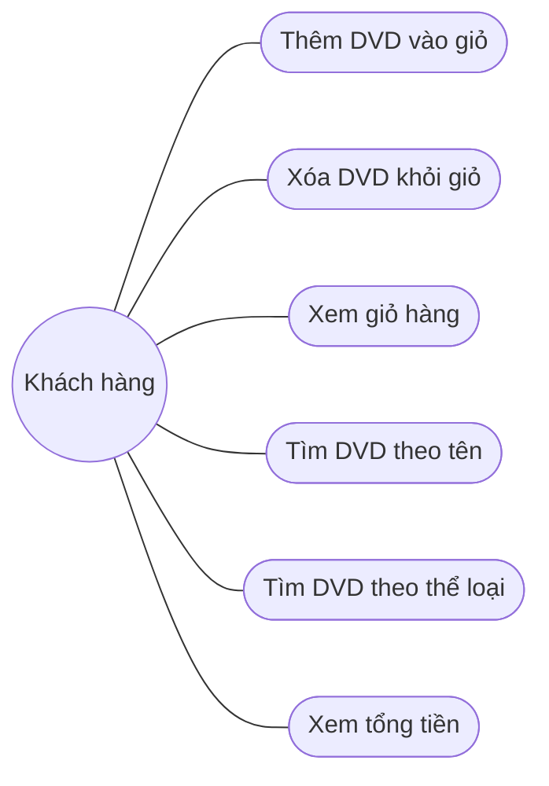

# Use case – AIMS-mini

Tác nhân: **Khách hàng**

| Use case | Mô tả | Ràng buộc |
|---|---|---|
| Thêm DVD vào giỏ | Khách thêm một DVD vào giỏ | Tối đa 20 đĩa |
| Xem giỏ hàng | In danh sách DVD | Giỏ trống thì báo "The cart is empty" |
| Tìm DVD theo tên | Tìm theo từ khóa trong tên | Không phân biệt hoa/thường |